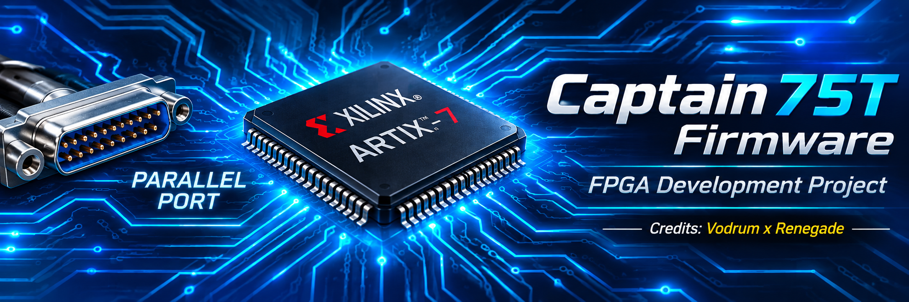

  

  Firmware e documentazione per la scheda FPGA Captain 75T.

  
  
  

---

## Panoramica

Questo rep ha l'intenzione di condividere un firmware basico "parallel-port".

Il firmware viene sviluppato utilizzando AMD Xilinx Vivado ed è destinato all'utilizzo con hardware compatibile. 

## Piattaforma hardware

| Parametro | Descrizione |
|---|---|
| Scheda | Captain 75T |
| Dispositivo | FPGA |
| Ambiente di sviluppo | AMD Xilinx Vivado |
| Formato firmware | `.bin` |
| Interfaccia | Interfaccia parallela |
| Versione | Consultare le Release |

> **Nota:** Essendo nato per l'universalità, permette il funzionamento su schede comprate da Aliexpress o derivati, così come le originali Captain.

## Caratteristiche

- Dna Lock: NO
- Drv Scan : OK
- Consigliato l'uso del downloader per il flash in board
- Sviluppato tramite Xilinx Vivado nei minimi dettagli
- Gestione delle versioni tramite GitHub Releases (non penso comunque di aggiornarlo)

## Download

I firmware ufficiali sono distribuiti attraverso la sezione GitHub Releases.

La release conterrà la relativa versione, le note di rilascio e i file firmware scaricabili.

## Installazione

Prima di programmare la FPGA, verificare sempre che il firmware sia compatibile con la propria revisione hardware.
I file qui elencati, sono da scaricare nel secondo computer.
- CH347 consigliato per il flash: [Scarica CH347](https://mega.nz/file/FRAgST7R#1a91JX6DK_NhiHsS3AtSLk-dZCGQvmNDMHAINhHIR_U)
- File C necessari: [Scarica File C ](https://mega.nz/file/NchAwRoT#XDLiYnYAqbYPu3xlqP-w1qNxrXM-KmlezqWkGS4Ucdk)
- Runtime necessari: [Scarica Runtime](https://mega.nz/file/1RwTjLzR#fb5N2o3RruXcqqzOpsoSD4rB-J3dFbn_VCIQPb74hXw)

## Avvertenze

Il firmware viene distribuito così com'è, senza garanzie esplicite.

Verificare sempre la compatibilità hardware e seguire le procedure di programmazione appropriate prima di caricare il firmware sulla FPGA.

L'autore non si assume responsabilità per eventuali danni hardware o malfunzionamenti derivanti da installazioni errate o utilizzi impropri.

Usatelo a vostro rischio e pericolo. 

